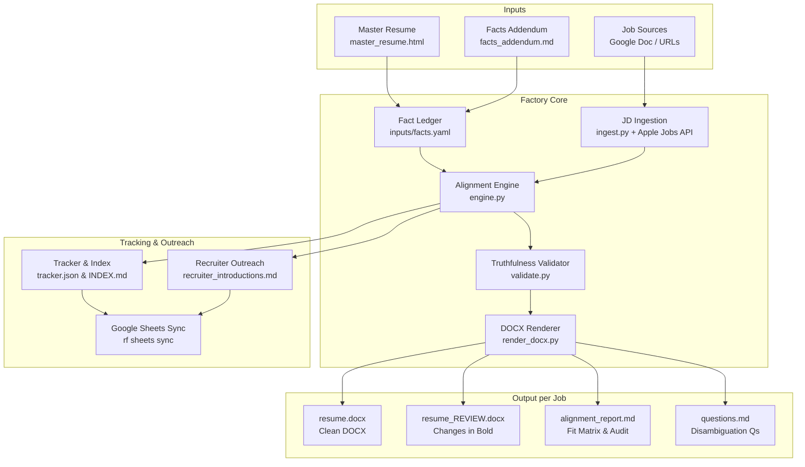

# Resume Aligner Factory

The **Resume Aligner Factory** is an automated pipeline that takes a single factual master resume and a list of job postings, and generates role-tailored, ATS-optimized `.docx` resumes formatted to the exact typographic and layout specifications of `SAMPLE_FORMAT.docx`.

It is built around strict engineering principles: **zero hallucination**, **grounded fact ledgers**, **age-neutral presentation**, **continuous chronological employment timelines**, and **dual review artifacts** (clean copy + review copy with tailored phrasing highlighted in bold).

---

## Table of Contents

- [Core Principles](#core-principles)
- [Architecture & Workflow](#architecture--workflow)
- [Directory Layout](#directory-layout)
- [Environment Setup](#environment-setup)
- [CLI Reference (`rf`)](#cli-reference-rf)
  - [1. Syncing Job Postings](#1-syncing-job-postings)
  - [2. Generating Tailored Resumes](#2-generating-tailored-resumes)
  - [3. Tracking & Status Management](#3-tracking--status-management)
  - [4. Syncing to Google Sheets](#4-syncing-to-google-sheets)
- [Generated Artifacts](#generated-artifacts)
- [Google Sheets Webhook & Custom Columns](#google-sheets-webhook--custom-columns)
- [Fact Ledger & Zero-Hallucination Gate](#fact-ledger--zero-hallucination-gate)
- [Testing & Quality Assurance](#testing--quality-assurance)

---

## Core Principles

1. **0% Hallucination (Deterministic Fact Ledger)**  
   Every bullet, tool, metric, team size, and role title is anchored in `inputs/facts.yaml`. No metrics or experiences are ever invented.
2. **Exact Visual Fidelity (`SAMPLE_FORMAT.docx`)**  
   All output resumes clone the underlying XML structures (`styles.xml`, `numbering.xml`, page margins) of `SAMPLE_FORMAT.docx`:
   - 0.5" (720 twips) margins on all sides.
   - 9 pt Times New Roman body text and bullet points.
   - 10 pt bold uppercase section headers with thin bottom borders.
   - Role headers: **Bold Company** | *Dates* | *Italic Title*.
   - Bullets: **`Bold Label:` plain sentence description**.
   - No tables, graphics, or nested columns that confuse ATS parsers.
3. **Age-Neutral Hygiene**  
   - Contact header limited to mobile phone and email (no street addresses or graduation years).
   - Oldest contiguous positions are truncated to maintain standard 10–15 year focus, while strategically retaining authentic heritage (e.g. LucasArts, Accolade) for specialized roles (such as gaming, 3D engines, or media pipelines).
   - **Continuous Employment Timeline**: Modern management and architect roles (2013–Present) are never omitted, ensuring zero gaps in employment history.
4. **Dual Review Artifacts**  
   For every target job, the factory produces both:
   - `resume.docx`: Clean, final document ready for submission.
   - `resume_REVIEW.docx`: Review document with tailored words and rephrased statements highlighted in **bold** for immediate human review.

---

## Architecture & Workflow



---

## Directory Layout

```
resume-aligner/
├── README.md                      # This documentation
├── plan.md                        # Master development plan and phase audit
├── SAMPLE_FORMAT.docx             # Visual and structural DOCX template
├── devenv.nix                     # Reproducible Nix developer environment
├── pyproject.toml                 # Python project configuration and dependencies
│
├── inputs/                        # Source of truth (inputs)
│   ├── master_resume.html         # Saved master resume from https://hsieh.org/resume/
│   ├── facts_addendum.md          # Additional verified facts, metrics, and clarifications
│   ├── facts.yaml                 # Compiled structured fact ledger (14 roles, 33 verified facts)
│   ├── job_list_source.txt        # Remembered Google Doc URL or local file path
│   └── sheets_webhook.txt         # Private Google Apps Script webhook URL (gitignored)
│
├── src/resume_factory/            # Factory source code
│   ├── cli.py                     # CLI dispatcher for `rf`
│   ├── engine.py                  # Alignment engine, prompt tailoring, and artifact generator
│   ├── ingest.py                  # Job description scraper (supports Apple Jobs API & archives)
│   ├── ledger.py                  # Fact parser & compiler into facts.yaml
│   ├── model.py                   # Data models (Role, Bullet, TailoredResume, etc.)
│   ├── parse_docx.py              # DOCX AST inspector & text extractor
│   ├── render_docx.py             # DOCX generator cloning SAMPLE_FORMAT styles
│   ├── sheets.py                  # Google Apps Script webhook integration
│   ├── tracker.py                 # Job tracking, hashing, and stale detection
│   └── validate.py                # Deterministic fact-check validator
│
├── work/                          # Cached intermediate artifacts
│   └── <job_id>/jd_raw.txt        # Raw fetched text for each job description
│
├── output/                        # Generated deliverables
│   ├── INDEX.md                   # Markdown dashboard of all tracked jobs
│   ├── tracker.json               # State database (status, hashes, output paths)
│   ├── recruiter_introductions.md # Tailored 2-sentence intro notes + LinkedIn search queries
│   └── <job_id>_<slug>/           # Folder per job posting:
│       ├── resume.docx            # Clean, submission-ready resume
│       ├── resume_REVIEW.docx     # Changes in bold for fast proofreading
│       ├── alignment_report.md    # Requirement-by-requirement alignment matrix
│       └── questions.md           # 3 clarifying questions for interview prep
│
└── tests/                         # Test suite
    ├── test_render_docx.py        # Roundtrip golden tests against SAMPLE_FORMAT.docx
    └── test_tracker.py            # Tracker state, hashing, and stale detection tests
```

---

## Environment Setup

The repository uses [devenv](https://devenv.sh/) (Nix) with Python 3.14 and `uv` to manage isolated dependencies automatically.

### 1. Enter the Environment
```bash
devenv shell
```
When entering the shell, `uv` automatically verifies and syncs all dependencies (`python-docx`, `lxml`, `pyyaml`, `beautifulsoup4`, `requests`, `pytest`).

### 2. Verify Installation
```bash
rf --help
```
You should see the `rf` CLI commands (`jobs`, `sheets`).

---

## CLI Reference (`./rf`)

The factory provides an ergonomic standalone CLI named `./rf` located right in the project root.

### 1. Syncing Job Postings from Google Sheets (Primary Workflow)

You manage job targets directly in your **Google Sheet**. Just paste new URLs in the `Job Posting URL` column, and run:

```bash
# Bi-directional sync with your Google Sheet:
./rf sheets sync
# (or simply: ./rf jobs sync)
```

This:
1. Discovers any new job links you added to your sheet and imports them into the factory pipeline.
2. Updates existing jobs in-place in the sheet with tailored resume file paths, recruiter search queries, and intro notes (matching by column header names).

#### Adding Jobs via CLI or Text File (Optional)
```bash
# Add an individual job posting directly:
./rf jobs add "https://jobs.example.com/details/123" --label "Company - Role Title"

# Or import from a shared Google Doc / text file:
./rf jobs sync "https://docs.google.com/document/d/<DOC_ID>/edit?usp=sharing"
```

### 2. Generating Tailored Resumes

Run the alignment engine to parse JDs, align skills, run the zero-hallucination validation check, and render all output DOCX and markdown files:

```bash
rf jobs align
```

This compiles:
- `output/<job_id>_<slug>/resume.docx`
- `output/<job_id>_<slug>/resume_REVIEW.docx`
- `output/<job_id>_<slug>/alignment_report.md`
- `output/<job_id>_<slug>/questions.md`
- Updates `output/tracker.json` and `output/INDEX.md`

### 3. Tracking & Status Management

Check current alignment status across all jobs:

```bash
# Summary list of all tracked jobs
rf jobs list

# Show only pending jobs that still need alignment or review
rf jobs list --pending

# Update job status manually (e.g. reviewed, applied, blocked)
rf jobs mark <job_id> applied --note "Submitted through company portal"
```

Valid statuses are: `pending`, `drafted`, `blocked`, `aligned`, `reviewed`, `applied`.

### 4. Syncing to Google Sheets

Push all tracked roles, tailored resume links, recruiter search queries, and tailored introduction messages to your Google Sheet:

```bash
rf sheets sync
```

---

## Generated Artifacts

For each role, the factory creates a dedicated directory inside `output/`:

| Artifact | Purpose |
|---|---|
| **`resume.docx`** | Clean Word document formatted to match `SAMPLE_FORMAT.docx`. Ready to be uploaded to ATS systems or emailed. |
| **`resume_REVIEW.docx`** | Word document where newly added or rephrased words are rendered in **bold**, making it effortless to audit changes against the master resume. |
| **`alignment_report.md`** | Comprehensive alignment matrix matching job description requirements against verified facts from the master resume, along with a factual integrity audit. |
| **`questions.md`** | 3 targeted questions per role to prepare for hiring manager interviews and resolve any ambiguous technical boundaries. |
| **`output/recruiter_introductions.md`** | Targeted 2-sentence introduction notes highlighting specific experience relevant to each role, paired with direct LinkedIn recruiter search URLs. |
| **`output/INDEX.md`** | Master catalog showing all positions, their current status, freshness (stale alerts if JD or master resume changes), and direct links to output artifacts. |

---

## Google Sheets Webhook & Custom Columns

The factory can sync directly with a personal Google Sheet using a lightweight Google Apps Script Web App.

### Webhook Configuration
The webhook URL is stored locally in `inputs/sheets_webhook.txt` (which is gitignored to protect privacy).

```
https://script.google.com/macros/s/<DEPLOYMENT_ID>/exec
```

### Security (`@OnlyCurrentDoc`)
The Google Apps Script uses the `/** @OnlyCurrentDoc */` annotation:
- It only has permission to view and modify **this specific spreadsheet**.
- It has zero access to any other files, drives, or docs in your Google account.

### Column-Name Based Mapping & Custom Columns
The Google Apps Script maps fields dynamically by **column name (header in Row 1)** rather than hardcoded column positions (A, B, C, etc.).

The factory looks for and updates these specific column names:
- `Status`
- `Company`
- `Role Title`
- `Job Posting URL`
- `Tailored Resume File`
- `Recruiter Search Query / Link`
- `Recruiter Intro Message`

#### Freedom to Customize Your Sheet
Because the script matches by column header name:
- **Columns can be in any order:** You can rearrange the factory columns however you prefer.
- **Insert custom columns anywhere:** You can place your own custom columns (*Application Date*, *Interview Stage*, *Recruiter Contact*, *Notes*, *Follow-up Date*, etc.) anywhere in the sheet — at the beginning, between factory columns, or at the end.
- **Values preserved:** Syncing updates only the matched factory columns and leaves all your custom columns and manual notes completely untouched.

---

## Configurable Directives (`inputs/directives.yaml`)

You can control resume tailoring policies, ageism screening cutoffs, and skills preservation directly in **`inputs/directives.yaml`**:

```yaml
ageism:
  # Maximum years of employment history shown (standard screening window)
  max_experience_years: 15

  # Cutoff year for chronological roles (e.g. 2011 to present)
  # Roles ending prior to this year are hidden from the experience section
  cutoff_year: 2011

  # When older roles are hidden, preserve and emphasize their authentic technical proficiencies
  # (e.g. C, Assembly, Java, Python, 3D real-time systems, SQL) in Key Skills & Tools
  preserve_skills_from_omitted_roles: true

  # Education hygiene: omit graduation year
  omit_graduation_year: true

  # Contact line hygiene: mobile and email only (no street/city address or LinkedIn)
  contact_header_style: "mobile_and_email_only"

truthfulness:
  strict_fact_ledger_validation: true
  grounded_citations_required: true
```

Whenever you run `./rf jobs align`, the factory automatically enforces your directives across all generated `.docx` resumes and review copies.

---

## Fact Ledger & Zero-Hallucination Gate

The factory strictly prevents AI hallucinations by decoupling fact storage from language generation.

1. **Master Sources**:
   - `inputs/master_resume.html`: Parsed from `https://hsieh.org/resume/`.
   - `inputs/facts_addendum.md`: Answers to clarifying questions, exact metrics, and team scopes.
2. **Fact Ledger (`inputs/facts.yaml`)**:
   - Compiles every verifiable assertion into a structured record with a unique ID (e.g., `bs-idp-01`, `bs-mw-02`).
3. **Validator (`src/resume_factory/validate.py`)**:
   - Analyzes generated resumes to ensure all numbers, metrics, technology names, and employer dates correlate directly with cited fact IDs.
   - Ensures continuous employment history from 2013 to present (no artificial career gaps).

---

## Testing & Quality Assurance

Run the automated test suite using `devenv`:

```bash
devenv shell -- pytest -q
```

Or run directly through devenv test:

```bash
devenv test
```

The test suite covers:
- **`tests/test_render_docx.py`**: Validates document margins, font sizes, style run inheritance, bottom borders, and paragraph-level cloning against `SAMPLE_FORMAT.docx`.
- **`tests/test_tracker.py`**: Tests URL canonicalization, ID stability, Google Doc parsing, idempotency, and stale detection when JDs or master facts change.
