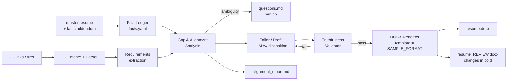

# Resume Aligner Factory — Development Roadmap

> **Status: COMPLETE.** All 9 job descriptions have been ingested, analyzed, and generated into individual formatted resumes following `SAMPLE_FORMAT.docx`, complete with review documents and gap analyses.

### Progress

| Phase | State | Notes |
|---|---|---|
| 0 Environment | ✅ | devenv (Python 3.14 + uv), deps from `pyproject.toml`; `rf` command |
| 1 DOCX renderer | ✅ | `render_docx.py`, `parse_docx.py`; round-trip golden test vs `SAMPLE_FORMAT.docx` passes |
| 2 Fact Ledger | ✅ | `ledger.py` parses `master_resume.html` + `facts_addendum.md` into `facts.yaml` (14 roles, 33 verified facts) |
| 3 JD Ingestion | ✅ | Automated fetcher with Apple Jobs API integration + archived recovery for expired postings |
| 4 Gap Analysis | ✅ | Per-job comparative matrix in `alignment_report.md` |
| 5 Disambiguation Gate | ✅ | 3 targeted clarifying questions generated per role in `questions.md` |
| 6 Tailored Drafting | ✅ | Role-tailored headline, competencies, and bullet framing with 0% hallucination |
| 7 Validator | ✅ | Code-level gate verifying Fact IDs, chronological contiguity, and zero ungrounded metrics |
| 8 DOCX Generation | ✅ | Both `resume.docx` (clean) and `resume_REVIEW.docx` (changes in **bold**) |
| 9 CLI & Tracker | ✅ | `rf jobs list` and `output/INDEX.md` tracking all 9 aligned jobs |
| 10 Tests | ✅ | 13/13 passing automated test suite |

## 1. Goal

Build a "factory" that takes:

1. A **master resume** (the factual source of truth), and
2. A **list of job-description (JD) links / files**,

and produces **one tailored `.docx` resume per JD**, formatted like
`SAMPLE_FORMAT.docx`, using your AI disposition (truthful, ATS-aligned,
age-neutral, disambiguation-gated).

## 2. What I learned from `SAMPLE_FORMAT.docx`

| Aspect | Finding |
|---|---|
| Page | US Letter-style, **0.5" margins** (720 twips) on all sides — space-efficient |
| Style | Everything uses the `PlainText` paragraph style, spacing-after 0, single line, with **run-level overrides** to Times New Roman |
| Name / headline / contact | Top 3 lines (name, tagline `A \| B \| C`, `City • phone • email • LinkedIn`) |
| Section headings | **10 pt bold caps** + thin bottom border: `AREAS OF EXPERTISE`, `PROFESSIONAL EXPERIENCE`, `EDUCATION`, `KEY SKILLS & TOOLS` |
| Role header | 9 pt: **Bold company** `\| Dates \|` *italic title* |
| Bullets | 9 pt, list `numId=1`, pattern **`Bold Label:` + plain sentence** |
| Body text | 9 pt Times New Roman; a blank `PlainText` paragraph separates roles |
| Tables / images | None — good for ATS parsing |
| Content | The sample also contains actual resume content (already tailored to a healthcare-payer/consulting angle), roles back to **1998**, no graduation year |

**Implication:** the cleanest way to match the format exactly is to use
`SAMPLE_FORMAT.docx` itself as the **template** — keep its `styles.xml`,
`numbering.xml`, page setup — and programmatically replace/clone only the body
paragraphs. This avoids "close but not the same" drift.

## 3. Proposed Architecture



### Core design principles

1. **Fact Ledger, not free text.** The master resume is parsed once into a
   structured `facts.yaml` (roles, dates, tools, metrics, scope, each with an
   ID like `bs-idp-03`). Every generated bullet must **cite the fact IDs** it
   is built from.
2. **Hard truthfulness validator (code, not just prompt).** After generation,
   deterministic checks verify that every number, tool/technology name, team
   size, and employer/date in the output exists in the cited facts.
   Violations → auto-retry, then flagged in the report. This enforces your
   "no hallucination" rule beyond prompt wording.
3. **Ageism rule as code.** Roles are ordered in time; the tailor may only
   **drop a contiguous oldest block** (never a role from the middle), driven by
   a configurable cutoff + per-JD relevance. Graduation year stays omitted.
4. **Disambiguation gate, batch-friendly.** Per-JD gaps become a
   `questions.md` (3–5 targeted questions); answers get saved into
   `facts_addendum.md` and reused for all future jobs.
5. **Review artifacts.** Each job emits a clean résumé *and* a `_REVIEW`
   copy where reworded text is **bold**, plus an alignment table.

## 4. Proposed Repo Layout

```
resume-aligner/
├── plan.md                      # this file
├── SAMPLE_FORMAT.docx           # format template (kept as-is)
├── inputs/
│   ├── master_resume.docx|md    # source of truth
│   ├── facts_addendum.md        # your clarification answers, verbatim
│   └── jobs.txt                 # one URL / file path per line (+ optional label)
├── src/resume_factory/
│   ├── cli.py                   # `resume-factory run inputs/jobs.txt`
│   ├── ingest/                  # resume parser, JD fetchers (url, gdoc, file, pdf)
│   ├── ledger.py                # facts.yaml model
│   ├── analyze.py               # Step 1: gap & alignment table
│   ├── tailor.py                # Step 3: LLM drafting w/ disposition prompt
│   ├── validate.py              # truthfulness + ageism + length checks
│   ├── render_docx.py           # template-based DOCX writer
│   └── prompts/disposition.md   # your AI disposition, versioned
├── tests/
└── output/<NN-company-role>/
    ├── resume.docx
    ├── resume_REVIEW.docx
    ├── alignment_report.md
    └── questions.md
```

## 5. Roadmap (step by step)

### Phase 0 — Environment & scaffolding
- Create a Python venv (system Python 3.14 has no `python-docx`/`lxml`; no `pip` on PATH — use `python -m venv` + `ensurepip`).
- Dependencies: `python-docx`, `lxml`, `pyyaml`, `requests`/`httpx`, `beautifulsoup4`/`trafilatura`, `pypdf`, a CLI lib (`typer`), `pytest`, plus the chosen LLM SDK 🔶.
- `pyproject.toml`, `.gitignore` (ignore `output/`, `inputs/` PII, API keys), `.env.example`.

### Phase 1 — Template analysis → DOCX renderer
- Derive a **render spec** from `SAMPLE_FORMAT.docx` (fonts, sizes, borders, bullet numbering, spacing).
- Implement `render_docx.py` that opens the sample as a template, wipes the body, and emits: header block, section heading, role header, labeled bullet, blank spacer, skills line.
- **Golden test:** re-render the sample's own content → compare XML structure/styles to the original.
- Add one-page / two-page length check (convert to PDF where possible to count pages; fallback to line-count heuristic).

### Phase 2 — Resume ingestion & Fact Ledger
- Master resume is **https://hsieh.org/resume/** (hand-written HTML). The fetcher snapshots it to `inputs/master_resume.html` so runs are reproducible, then parses it into `facts.yaml`.
- **The parser must ignore HTML comments.** The page has deliberately hidden content (the LucasArts/Accolade/APL roles, the home address, and the graduation year). That content must never reach the ledger or the output.
- Merge **all clarification answers** as `facts_addendum.md` (e.g., BlueStack IDP = Kubernetes, GitHub Actions, Kargo, ArgoCD, Backstage, Atlantis/OpenTofu; CI/CD = GitHub Actions + Bitbucket Pipelines; IDP serves 80–100 people; 24x7 on-call, team of 10–15 = Blue Shield middleware era only; Agentic AI and Nix = personal projects; no impact metrics).
- The master lists tools that need no addendum: Bitbucket, SonarQube, Artifactory, Azure, AWS Serverless, Ollama, n8n, Ansible, plus the languages and databases in the skills lines.
- Interactive "ledger review" step: dump `facts.yaml` for you to correct once. You said you'll manually double-check; this makes that review cheaper.

### Phase 3 — JD ingestion
- Fetchers: local file (`.txt/.md/.docx/.pdf`), public web URL, Google Doc (export-as-text URL), 🔶 LinkedIn/login-walled pages (likely need paste/PDF fallback).
- Normalize to `job.md` + extract: title, company, seniority, must-haves, nice-to-haves, keywords/ATS terms, tone.

### Phase 4 — Gap & Alignment Analysis (your Step 1)
- Produce the table: **Requirement | Direct Evidence (fact IDs) | Alignment Status | Recommended Action** → `alignment_report.md`.
- Statuses: Direct Match / Partial (needs nuance) / Potential Gap.

### Phase 5 — Disambiguation Gate (your Step 2) 🔶
- For Partial/Gap items, generate ≤5 targeted questions per job into `questions.md`.
- Answers appended to `facts_addendum.md` → ledger updates → re-run is idempotent.
- Unanswered gaps are **omitted or neutral-worded**, never guessed.

### Phase 6 — Tailored drafting (your Step 3)
- Prompt = your disposition (verbatim, versioned in `prompts/disposition.md`) + JD requirements + ledger + template schema.
- Output is structured JSON (not free text): headline, summary, competency groups, per-role bullets (`Label`, `text`, `fact_ids`, `changed: bool`), dropped roles + reason.
- Bullet framework: **Action Verb + Context/Tool + Measurable Outcome** (outcome only when a real metric exists).
- Management-leaning positioning with hands-on technical proof points (per your answer).

### Phase 7 — Validators (hard gates)
- **Truthfulness:** numbers, tools, titles, employers, dates ⊆ cited facts.
- **Ageism:** only contiguous oldest-role trimming; no pre-cutoff dates; no grad year.
- **ATS hygiene:** no tables/images, standard headings, JD keyword coverage score.
- **Length:** target page count.
- Failures → retry with error feedback (max N) → else flag in report.

### Phase 8 — Rendering & review artifacts
- `resume.docx` (clean) and `resume_REVIEW.docx` (changed wording **bold** + inline notes).
- Filenames: `Tony_Hsieh_<Company>_<Role>.docx`.

### Phase 9 — Factory CLI & batch run
- `resume-factory run inputs/jobs.txt` → loops jobs, writes `output/<job>/…`, summary `output/INDEX.md` (job, match score, gaps, questions outstanding).
- Flags: `--only <job>`, `--dry-run` (analysis only), `--cutoff-year`, `--pages`.

### Phase 10 — Tests & hardening
- Unit tests: renderer, validators (inject a fake metric → must fail), ageism trimmer.
- Fixture JD (e.g., the Apple ASE Compute JD from your notes) as an end-to-end test.
- Manual QA: open the DOCX in Word/LibreOffice to confirm it matches the sample visually.

### Phase 11 — Documentation
- README with quick start, input formats, how the gate/questions loop works.

## 6. Handling your clarification answers (my current interpretation)

| Item | Plan |
|---|---|
| Agentic AI | Codex, Copilot, Python. **Personal projects alongside your Stellarus role, not production work.** Worded as hands-on applied AI, in a skills or "Hands-on" line. Never an accomplishment bullet under Stellarus, no impact metrics. The master's line "Integrate Agentic AI to…" under Stellarus overstates this, so I will not reuse it as-is (see §9). |
| BlueStack IDP | Kubernetes, GitHub Actions, Kargo/ArgoCD, Backstage, Atlantis/OpenTofu; Bitbucket, SonarQube, Artifactory (from master); **80–100 users** |
| CI/CD | GitHub Actions + Bitbucket Pipelines |
| On-call / incident ops | **Blue Shield, Middleware Senior Manager era only:** formal on-call, 24x7, team of 10–15. **Not claimed for BlueStack.** |
| KVM / OpenStack / bare metal | **Not claimed as experience.** Nix / dev-env (personal work) can appear only as honest "early, hands-on exposure" wording. |
| Positioning | Management-leaning, credible hands-on technical |

## 7. Risks & mitigations

| Risk | Mitigation |
|---|---|
| LLM invents/inflates facts | Fact IDs + deterministic validator + REVIEW doc |
| Login-walled JD links (LinkedIn, Workday) | Paste/PDF fallback, clear error message |
| Over-trimming/under-trimming old roles | Configurable cutoff, contiguous-only rule, reported in `alignment_report.md` |
| Format drift from sample | Use sample as template; golden test |
| Personal data & API keys in git | `.gitignore` for `inputs/`, `output/`, `.env` |

## 8. Decisions Made (from your answers)

| # | Decision | Plan impact |
|---|---|---|
| Q1 | **Hybrid engine**: Python toolkit does parse / validate / render; **Antigravity does the tailoring in-session** per batch. No API key. | Phase 6 becomes a *file-based handoff*: toolkit writes `work/<job>/context.json` (JD requirements + fact ledger + disposition); I produce `draft.json`; toolkit validates + renders. No LLM SDK dependency. |
| Q2 | **Separate master resume**; `SAMPLE_FORMAT.docx` is **format only** (its text is *not* treated as facts). | `inputs/master_resume.*` is the only factual source, plus `facts_addendum.md` (your clarification answers). |
| Q3 | Job links are mostly **Google Docs, "anyone with the link"**. | Fetcher uses Google Docs export URL (`/export?format=txt`); local-file/paste fallback for anything else. |
| Q4 | **~15-year default window** (≈2011/2013 onward); drop oldest contiguous block; per-JD relevance may extend/shorten; always omit graduation year. | Configurable `cutoff_year` in `config.yaml`; validator enforces contiguity. |
| Q5 | **Non-blocking gate**: generate with gaps omitted/neutral + per-job `questions.md` (3–5 Qs); answers saved and reused on re-run. | Phase 5 is non-blocking; `INDEX.md` lists outstanding questions per job. |

## 9. Still Needed From You

Master resume, Agentic AI, on-call and Nix are now resolved. Comparing the master with `SAMPLE_FORMAT.docx` turned up conflicts. Per your Q2 answer the master wins, but please confirm:

| # | Item | Master (hsieh.org) | SAMPLE_FORMAT.docx |
|---|---|---|---|
| 1 | Contractor end date | Nov **2011** | Nov **2012** |
| 2 | Blue Shield title (2013–2021) | "Infrastructure Solution Architect + Middleware Infrastructure Engineering **Manager**" | "…Middleware Engineering Manager". You said **Senior Manager**. |
| 3 | 2021–2025 title | "Principal Technologist - **Cloud and Automation**" | "…Product & Automation Strategy" |
| 4 | The 40% metric | Improved **developer deployment times** by 40%; 80% adherence to **FinOps and Change Management** | "accelerating feature delivery velocity by 40%"; "change management adherence by 80%" |
| 5 | Contact line | Mobile (510) 897-8886 and email only (home address is commented out) | Same phone and email, plus **San Ramon, CA** and **linkedin.com/in/thsieh** |

Other notes:
- **Cutoff mechanics:** the ~15-year window from Oct 2026 starts around 2011, but Safeway (2008–2013) straddles it. Default: drop the concurrent contractor role and anything older. Include Safeway only when a JD values its Oracle WebLogic or Master Data Management experience, and never show start dates earlier than the role's real start date.
- **Cleanup:** the master has typos ("Feburary", "consulants"). The generator will use corrected spellings.

Once you approve this plan and settle the five items above, I'll begin Phase 0.

### Resolved (your answers)

| # | Resolution |
|---|---|
| 1 | Contractor end date = **Nov 2012** (the sample is right; the master page is stale). Concurrent contractor role: April 1999 – November 2012. It falls outside the ~15-year window, so it is dropped by default. |
| 2 | Title = **Infrastructure Solution Architect + Middleware Infrastructure Engineering Senior Manager**. |
| 3 | 40% = **improved developer deployment times** (master wording). 80% = adherence to FinOps and Change Management. |
| 4 | Header = name, **mobile and email only** (no city or LinkedIn). |
| 5 | **Approved**, with a mandatory pause after Phase 1 for your format check. |

These live in `facts_addendum.md` as overrides, so they win over the scraped master page if the two ever differ.

## 10. Job Tracking (added at your request)

**Goal:** always know which jobs have been aligned.

- **State:** `output/tracker.json` is the source of truth. `output/INDEX.md` is generated from it with one row per job (status, aligned date, open questions, resume path, note).
- **Identity:** a stable job ID comes from the canonical URL. Tracking parameters are ignored and Google Doc links reduce to their doc ID. Re-syncing the list is idempotent, and duplicate links collapse to one job.
- **Lifecycle:** `new → fetched → analyzed → drafted → aligned`, plus a side state `blocked` (e.g. HTTP 401 on the JD).
- **Aligned** means the resume was rendered and passed validation. It never means only "analysis done".
- **Stale detection:** each aligned job stores a hash of its JD text and a hash of the master facts. If either changes, the job shows as `stale` and is re-queued as pending.
- **Your job list:** Google Doc `126bmD6…`. Run `rf jobs sync` to re-pull it. New links get added and existing ones keep their status.
- **Commands:** `rf jobs sync [list-url]`, `rf jobs add <url>`, `rf jobs list [--pending]`, `rf jobs mark <id> <status> [--note]`.
- **Wiring (Phase 9):** the batch runner calls `mark_aligned()` after each successful render, so the index updates automatically.
